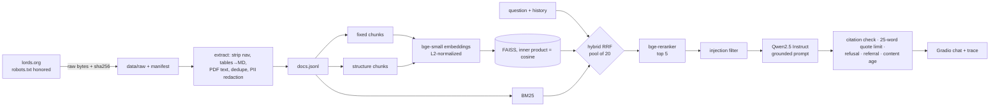

# 00 · Proposal

> **Team to complete:** team members and GitHub handles, who owns which stage (link the project board).

## Domain and user
Professional sports rulebook: the **Laws of Cricket** published by MCC (lords.org). The user is a club
cricketer, captain, scorer or newly qualified umpire who needs the exact rule during or before a match.
A wrong answer matters: it can decide a dismissal, award penalty runs, or change a result.

## Corpus plan
Public, unauthenticated pages under `https://www.lords.org/mcc/` (each of the 42 Laws, the Preamble /
Spirit of Cricket, appendices, guidance and news about Law changes) plus the PDFs linked from them.
Scope is defined in `crawl_config.json`. Target: ≥150 pages, ≥5 PDFs, ≥3 pages with data tables.
Excluded: login/account/shop/ticket pages and any member, staff, player or committee directory.

> **Team to confirm on Friday:** check `https://www.lords.org/robots.txt` and that the scope reaches 150
> pages; if not, widen `allowed_path_prefixes` or add a second public rulebook source and say so here.

## Stack
| Stage | Choice | Why |
|---|---|---|
| Crawl | `requests` + `urllib.robotparser` | robots.txt enforced in code; ≥1 s between requests |
| Extract | BeautifulSoup/lxml, pypdf | boilerplate stripping, tables → Markdown, PDF text |
| Embedding | `BAAI/bge-small-en-v1.5` (384-d) | strong English retrieval model that runs on CPU; better than MiniLM-L6 on BEIR/MTEB retrieval |
| Vector DB | FAISS `IndexIDMap2(IndexFlatIP)` + JSON metadata sidecar | exact cosine search, metadata filtering, delete by id/metadata, deterministic string ids |
| Sparse | Okapi BM25 (own implementation) | exact Law numbers and terms ("Law 41.3", "no ball") |
| Fusion | Reciprocal Rank Fusion, k = 60 | no score calibration needed between dense and BM25 |
| Reranker | `BAAI/bge-reranker-base` cross-encoder | large lift over bi-encoder ranking; small enough for CPU |
| Generator | `Qwen/Qwen2.5-1.5B-Instruct` (override with `RAG_LLM`) | follows "cite [n]" and refusal instructions far better than flan-t5; runs on a free Colab T4 or CPU. `Qwen2.5-3B-Instruct` is the upgrade if a GPU is available |
| UI | Gradio 5 | chat history, Markdown links, accordion trace |

## Architecture

## Chunk ID scheme
`<strategy>-<doc_id>-<chunk_index:04d>-<sha1(chunk_text)[:8]>` where `doc_id = sha1(source_url)[:16]`.
Same text → same id, so re-indexing is idempotent; the strategy prefix makes stale chunks of the other
strategy easy to find and delete.

## Evaluation plan
40+ hand-written golden items (quotas in `eval/README.md`), stratified 60/40 dev/test; baselines B0–B3;
one-factor ablation B2 → A1 (structure chunks) → A2 (hybrid) → B3 (rerank); paired bootstrap CIs and
McNemar tests; ≥15 hand-labeled failures. Test split is run once (enforced by the CLI).

## Crawl and PII policy
robots.txt parsed and enforced per URL; `max(1 s, Crawl-delay)` between requests; User-Agent names the
project and a contact e-mail; no login-walled or directory pages; pages that look like contact directories
are dropped and e-mail addresses / phone numbers are redacted from everything kept.
